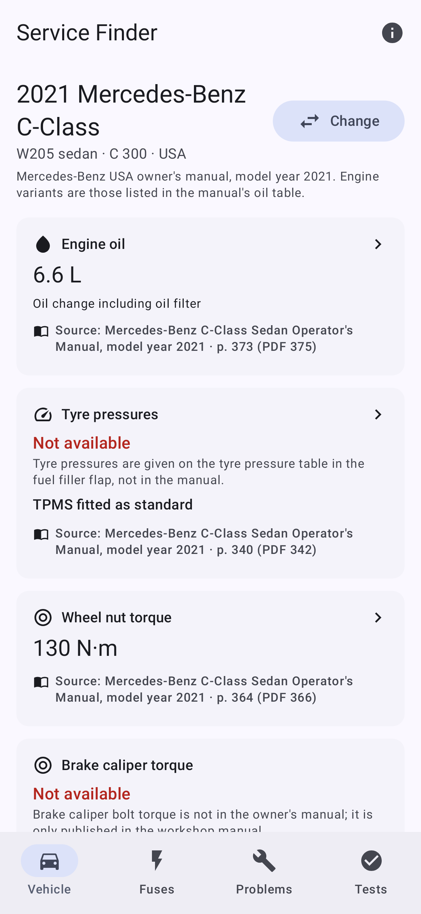
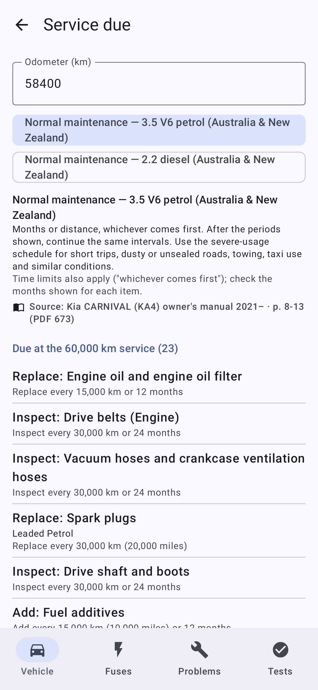
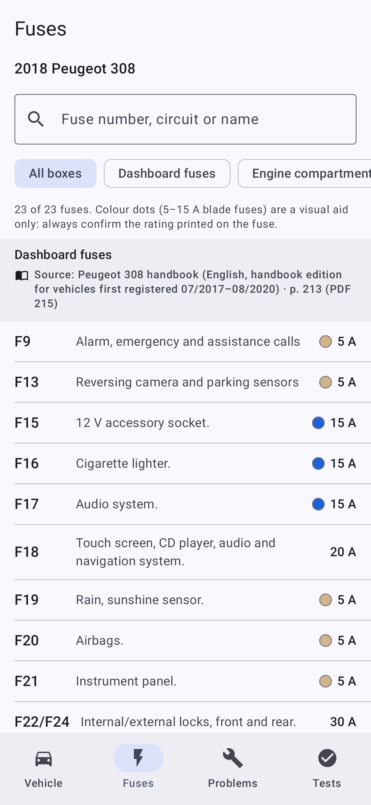
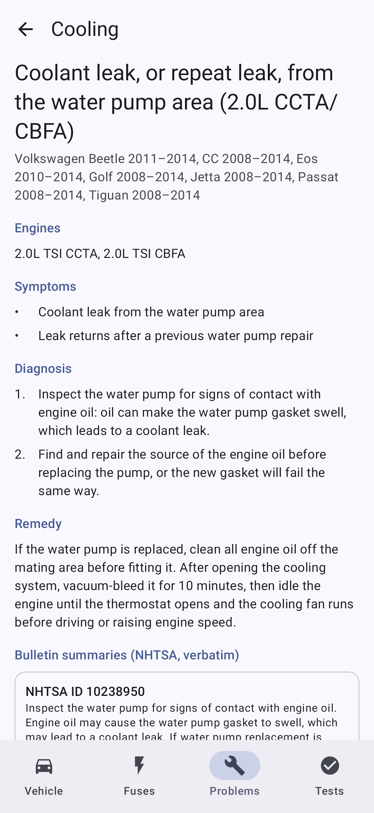
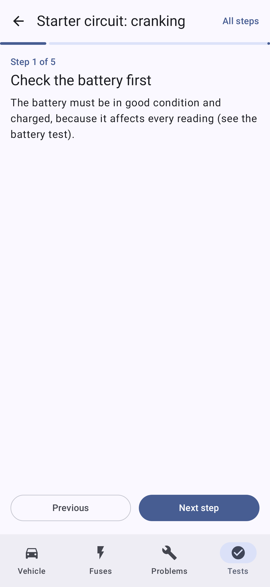

# Service Finder 2

An offline reference app for vehicle technicians, rebuilt from the original
`ServiceFinder-debug-2.apk` (still in the repository root for reference). It keeps the
package name (`com.servicefinder.app`), the name, the blue `#1F4E8C` drop icon and
the idea of a cited manual library. It is now a Kotlin and Jetpack Compose app
built against Android 17 (API 37).

For the selected make, model, year and engine it shows:

- **Quick menu**: engine oil capacity, tyre pressures, whether TPMS is fitted,
  wheel nut torque, brake caliper torque, and the service items due at the next
  service for an entered odometer reading.
- **Fuses**: searchable by fuse number, circuit or name, and filterable by fuse box.
- **Common problems**: symptoms, diagnosis, affected engines and remedy, each
  restated from manufacturer bulletins filed with the US NHTSA. Example: the
  VW 2.0L CCTA/CBFA water-pump coolant leak.
- **Electrical tests**: step-by-step walkthroughs (battery, parasitic drain,
  charging, starter voltage drop and current draw, voltage drop, CAN bus and
  others) from the starting textbook.

Every value shows its source document and page. **Values are never estimated.**
When no source gives a figure, the app shows *Not available* and the reason, for
example: "Tyre pressures are given on the tyre pressure table in the fuel filler
flap, not in the manual."

| Quick menu | Service due | Fuses | Problem | Test step |
|---|---|---|---|---|
|  |  |  |  |  |

## Building

Requirements:

- A current Android Studio release that supports **Android Gradle Plugin 9.4**.
  Open the repository root as the project.
- Android SDK **Platform 37** (Android 17) and **Build-Tools 37.0.0**. Install them
  from the SDK Manager, or with
  `sdkmanager "platforms;android-37.0" "build-tools;37.0.0"`.
- JDK 17 or newer. Android Studio's bundled JDK works. The command line was tested
  with JDK 21.

```sh
./gradlew :app:assembleDebug            # app/build/outputs/apk/debug/app-debug.apk
./gradlew :app:testDebugUnitTest        # unit, catalogue-integrity and screenshot tests
./gradlew :app:recordRoborazziDebug     # re-record screenshots into app/build/outputs/roborazzi
./gradlew :app:lintDebug
```

### Release APK

`ServiceFinder-2.0.0-release.apk` in the repository root is the signed, minified release
build as first published; it predates the performance changes below, so build a new one
from the current code. To sign your own builds, create a `keystore.properties` file (it is ignored by git):

```properties
storeFile=/path/to/servicefinder-release.jks
storePassword=…
keyAlias=servicefinder
keyPassword=…
```

Put it in the project root, or point the `SERVICEFINDER_SIGNING` environment variable at it,
then run `./gradlew :app:assembleRelease`. Without it, the release build is produced
unsigned. Android only installs an update over an existing install when both are signed
with the same key, so keep the keystore and its password safe.

Install it on a device with USB debugging on:

```sh
adb install -r app/build/outputs/apk/release/app-release.apk
# Optional, Android 9+: install with the baseline profile so it applies from the first launch
adb install-multiple -r app/build/outputs/apk/release/app-release.apk \
    app/build/outputs/apk/release/baselineProfiles/0/app-release.dm   # .../1/... on Android 9–11
# Or compile the installed app against its profile straight away
adb shell cmd package compile -f -m speed-profile com.servicefinder.app
```

Without either, `androidx.profileinstaller` writes the profile on first launch and Android
compiles it during the next idle maintenance window, so the speed-up arrives a launch or a
day later.

Toolchain versions are in `gradle/libs.versions.toml`:

| Component | Version |
|---|---|
| Gradle | 9.8.2 (wrapper) |
| AGP | 9.4.1 (built-in Kotlin) |
| Kotlin | 2.4.21 |
| KSP | 2.3.12 |
| Compose BOM | 2026.09.00 (Material 3 1.4) |
| Room | 2.8.5 |
| DataStore | 1.3.0 |
| Navigation 3 | 1.2.0 |
| Lifecycle | 2.11.0 |
| kotlinx-serialization | 1.12.0 |
| Robolectric | 4.17 (runs on SDK 36; it does not yet ship an API 37 image) |
| Roborazzi | 1.77.0 |

SDK levels: `compileSdk` 37, `targetSdk` 37, `minSdk` 26.

The app asks for **no permissions**. The catalogue is bundled and works fully
offline. "Open document" in a citation hands the publisher's URL to the browser.

## Architecture

```
app/src/main/assets/catalog.json    built by tools/build_data.py, never edited by hand
        │  imported on first launch, and again only when its checksum changes
        ▼
data/      Catalog.kt (serializable model) · CatalogDatabase.kt (Room) · CatalogRepository.kt
           SelectionStore.kt (DataStore: selected vehicle, recent vehicles, odometer)
domain/    ServicePlan.kt (which schedule items fall due) · ModelOptions.kt (picker choices)
ui/        AppRoot.kt (Navigation 3 + NavigationSuiteScaffold) and one package per area:
           vehicle (quick menu, picker, specifications, service), fuses, problems, tests, sources
```

- **One repository, no DI framework.** `ServiceFinderApp` creates the Room
  database, the repository and the DataStore. Screens use small ViewModels that
  combine flows from these.
- **Room as a search cache.** Each row stores the original catalogue object as
  JSON, plus the columns used for filtering. Fuse and problem search are indexed
  `LIKE` queries. A schema change rebuilds the database from the asset.
- **Navigation 3** uses `@Serializable` keys, so the back stack survives process
  death, and back gestures are predictive. Tabs sit above the Vehicle tab, so Back
  returns to the quick menu before leaving the app.
- **Adaptive layout.** `NavigationSuiteScaffold` switches between a bottom bar and
  a rail. The quick menu is an adaptive grid. Android 17 ignores orientation and
  resizability locks on large screens, so no screen depends on them.
- **Platform features**: edge-to-edge, dynamic colour (Android 12+) with a brand-blue
  palette as fallback, light and dark themes, a splash screen held until the first
  import finishes, an adaptive and themed (monochrome) launcher icon, and
  loading, empty and error states on every screen.
- **Accessibility.** Headings are marked as headings, icons inside labelled
  controls carry no duplicate descriptions, and the walkthrough step text is a
  polite live region. Text uses Material type styles and scales with the system
  font size.
- **Performance.** Rows are decoded from JSON on `Dispatchers.Default`, never on the main
  thread, and decoded vehicles and problems are memoized by their JSON (the catalogue does
  not change between imports). The preferences file is read while the catalogue is checked,
  so the quick menu is ready when the splash screen goes. `app/src/main/baseline-prof.txt`
  adds the app's own code, kotlinx.serialization, Room/SQLite, Navigation 3 and the splash
  screen to the baseline profile (Compose, Lifecycle and DataStore ship their own), so they
  are compiled ahead of time instead of interpreted on the first launches.
- **Icons** are Material Symbols paths stored as vector drawables. The
  `material-icons-extended` artifact is deprecated, so the app does not use it.

## Data pipeline (`tools/`, `data/`)

Curated data lives in TOML and every entry is checked when the catalogue is built:

```
data/sources.toml          every source document: publisher, URL, page count, SHA-256
data/vehicles/*.toml       per vehicle: engines, oil, tyres, TPMS, torques, fuse pages, schedule tables, gaps
data/problems/*.toml       per make: problems citing NHTSA bulletin IDs
data/procedures/*.toml     electrical test walkthroughs citing textbook pages
data/extracted/            machine-extracted tables (fuses, schedules, page labels, NHTSA summaries)
```

```sh
python3 -m venv .venv && . .venv/bin/activate && pip install -r tools/requirements.txt
python tools/fetch_sources.py     # downloads manuals into tools/work/pdfs and checks SHA-256
python tools/extract_all.py       # fuse tables, maintenance grids, page labels -> data/extracted
python tools/extract_nhtsa.py     # NHTSA summaries cited by data/problems (needs the CSVs, see the script)
python tools/build_data.py        # validates everything, writes app/src/main/assets/catalog.json
```

`build_data.py` stops instead of guessing. It fails on any of these:

- a figure without a page
- a page beyond the end of the document
- a value outside a plausible range (oil 1–20 L, tyres 150–700 kPa, wheel torque 40–400 N·m)
- an unmapped schedule variant
- an extracted row marked for review

The tyre and oil tables were also checked visually: the PDF pages were rendered
to images and compared with the extracted values. `CatalogIntegrityTest` repeats
the main checks against the built asset, using the app's own model classes.

Each citation records both the PDF page and the page number printed on the paper,
for example "p. 8-15 (PDF 675)".

## Sources

**Starting book.** *Automotive Mechanics*, 10th edition (May and Simpson,
McGraw-Hill Education (Australia), 2018). It is a library copy supplied by the user
and is **not redistributed**. The twelve electrical tests paraphrase its general
procedures and cite printed pages 872–999. Its figures are guide values: the
manufacturer's specification takes precedence, and the app says so. The few steps
that are general workshop practice rather than from the book are labelled as such.

**Owner's manuals** (public downloads from the manufacturers; URLs and hashes are in
`data/sources.toml`):

- **Kia**: Carnival, Cerato, Sorento, Sportage, Stonic. Hong Kong English editions,
  with Australia/New Zealand service schedules.
- **Hyundai UK**: i30 N, Kona, Santa Fe, Tucson.
- **Mazda Australia**: Mazda2, Mazda3.
- **Mercedes-Benz USA**: A, C (W205 and W206), CLA, E, GLA, GLB, GLC and GLE.
- **Stellantis public documentation site** (`public.servicebox.peugeot.com`, the
  address printed in the handbooks): Peugeot 208, 2008, 308, 3008/5008 (two
  editions) and Citroën C3. Fetch them with `tools/fetch_ddb.py`.

**NHTSA manufacturer communications.** US government data, in the public domain.
These cover 75 problems across VW, Audi, BMW, MINI, Mercedes-Benz (including the
Sprinter), Volvo, Porsche and Land Rover. NHTSA publishes only a short summary of
each bulletin. The app restates it and also shows the summary verbatim. The full
procedure, part numbers and specifications are in the manufacturer's service
information.

### Sources that could not be obtained

| Source | Why |
|---|---|
| VW, Škoda, BMW owner's manuals | Behind VIN-gated portals |
| Audi | Captcha |
| Volvo, Fiat, Porsche | HTTP 403 to automated requests |
| Renault, MINI | Sites unreachable from the build environment |
| Land Rover | VIN and captcha |
| Mercedes-Benz EU/UK manuals | Not found (404). The US manuals were used instead |
| MG ZST manual | Scanned images only, no text |
| Any workshop or service manual | Not publicly available. This is why there is no brake caliper torque anywhere |

Captchas and VIN logins were not bypassed. If you hold a manual for one of these
models, or a VIN you are entitled to use, add it to `data/sources.toml` and a
vehicle TOML, then rebuild.

## Coverage and gaps

Vehicles with owner's-manual data (✓ means present and cited; — means *Not
available* in the app, with the reason):

| Vehicle | Market | Oil | Tyres | TPMS | Wheel torque | Caliper | Service | Fuses | Problems |
|---|---|---|---|---|---|---|---|---|---|
| Citroën C3 (B618) 2020–22 | UK | — | — | unknown | — | — | — | 23 | — |
| Hyundai i30 N (PDe) 2021–23 | UK | ✓ | ✓ | optional | ✓ | — | — | 63 | — |
| Hyundai Kona (SX2) 2024–25 | UK | ✓ | ✓ | standard | ✓ | — | — | 98 | — |
| Hyundai Santa Fe (MX5) 2025 | UK | ✓ | ✓ | standard | ✓ | — | — | 114 | — |
| Hyundai Tucson (NX4) 2025 | UK | ✓ | ✓ | standard | ✓ | — | — | 99 | — |
| Kia Carnival (KA4) 2021–23 | AU/NZ | ✓ | ✓ | optional | ✓ | — | ✓ | 112 | — |
| Kia Cerato (BD) 2019–21 | AU/NZ | ✓ | ✓ | optional | ✓ | — | ✓ | 85 | — |
| Kia Sorento (MQ4) 2021–23 | AU/NZ | ✓ | ✓ | optional | ✓ | — | ✓ | 103 | — |
| Kia Sportage (NQ5) 2022–24 | AU/NZ | ✓ | ✓ | standard | ✓ | — | ✓ | 92 | — |
| Kia Stonic (YB) 2021–23 | AU/NZ | ✓ | ✓ | optional | ✓ | — | ✓ | 139 | — |
| Mazda2 (DJ/DL) 2020–23 | AU | ✓ | ✓ | standard | ✓ | — | ✓ | 65 | — |
| Mazda3 (BP) 2019–20 | AU | ✓ | ✓ | standard | ✓ | — | ✓ | 79 | — |
| Mercedes A-Class (V177) 2021 | USA | ✓ | — | standard | ✓ | — | — | — | 1 |
| Mercedes C-Class (W205) 2021 | USA | ✓ | — | standard | ✓ | — | — | — | 2 |
| Mercedes C-Class (W206) 2023 | USA | ✓ | — | standard | ✓ | — | — | — | 2 |
| Mercedes CLA (C118) 2021 | USA | ✓ | — | standard | ✓ | — | — | — | 1 |
| Mercedes E-Class (W213) 2021 | USA | ✓ | — | standard | ✓ | — | — | — | 2 |
| Mercedes GLA (H247) 2021 | USA | ✓ | — | standard | ✓ | — | — | — | 1 |
| Mercedes GLB (X247) 2021 | USA | ✓ | — | standard | ✓ | — | — | — | — |
| Mercedes GLC (X254) 2023 | USA | ✓ | — | standard | ✓ | — | — | — | 1 |
| Mercedes GLE (W167) 2021 | USA | ✓ | — | standard | ✓ | — | — | — | 1 |
| Peugeot 208 (A9) 2016–17 | UK | — | — | unknown | — | — | — | 31 | — |
| Peugeot 2008 (A94) 2016–17 | UK | — | — | unknown | — | — | — | 32 | — |
| Peugeot 308 (T9) 2017–20 | UK | — | — | unknown | — | — | — | 23 | — |
| Peugeot 3008/5008 (P84) 2017–19 | UK | — | — | unknown | — | — | — | 46 | — |
| Peugeot 3008/5008 (P84) 2020–22 | UK | — | — | unknown | — | — | — | 44 | — |

Models with **common problems only**. These are listed in the picker as "Problems
only", and every other figure shows *Not available*:

- **VW**: Golf, Jetta, Passat, Tiguan, CC, Beetle, Eos, Touareg
- **Audi**: A3, A4, A5, A6, Q3, Q5, Q7, TT
- **BMW**: 3, 4 and 5 Series, X1, X3, X4, X5, X6
- **MINI**: Cooper/Cooper S, Clubman, Convertible, Countryman
- **Mercedes-Benz**: A, C, CLA, E, GLA, GLC, GLE, Sprinter
- **Volvo**: S60, S90, V60, XC60, XC70, XC90
- **Porsche**: Cayenne, Macan, Panamera
- **Land Rover**: Range Rover, Range Rover Sport, Evoque, Discovery 4/LR4, Freelander 2/LR2

Known gaps, which the app explains on screen:

- **Brake caliper torque**: none. This figure only appears in workshop manuals,
  and none were accessible.
- **Mercedes-Benz**:
  - Tyre pressures are on the fuel-flap label, not in the manual.
  - Fuse allocation is on the chart in each fuse box.
  - Service is condition-based (ASSYST PLUS), with no fixed schedule.
  - The CLA 250 oil capacity is blank in its manual, so it is not given.
- **Peugeot/Citroën**:
  - The handbooks give fuses and indirect under-inflation detection only.
  - Oil capacity and wheel bolt torque are not in the handbooks.
  - Tyre pressures are on the door-pillar label.
  - Service intervals are in a maintenance guide that is not publicly available.
  - TPMS fitment is shown as "not stated" because the handbooks do not say
    whether it is standard.
- **Hyundai UK**: service schedules are in the separate service booklet.
- **Markets**: figures apply to the market the manual was written for (shown on
  every vehicle). European variants can differ.
- **Common problems**: these come from US-market bulletins. Check that the market,
  engine and build date match before acting on one.

## Copyright

- **Owner's manuals and the textbook** remain the property of their publishers.
  The repository holds only facts extracted from them (values, fuse allocations,
  schedule intervals) with citations, plus paraphrased procedures. The PDFs
  themselves are not committed: `tools/work/` is ignored by git.
- **NHTSA data** is in the public domain.
- **The app icon** is the original Service Finder drop mark.
