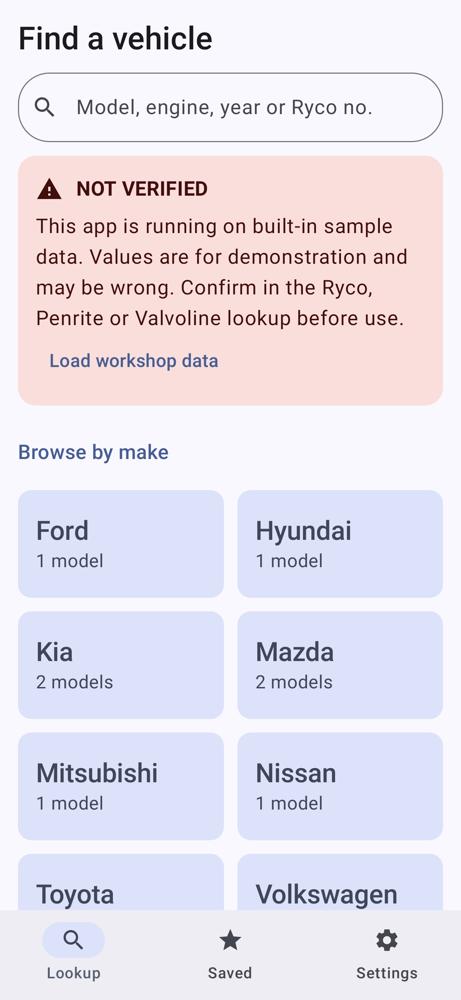
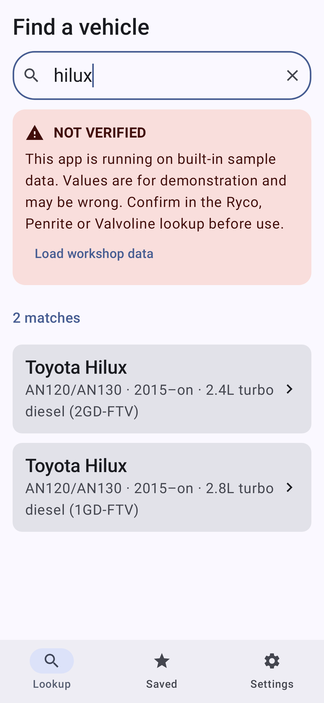
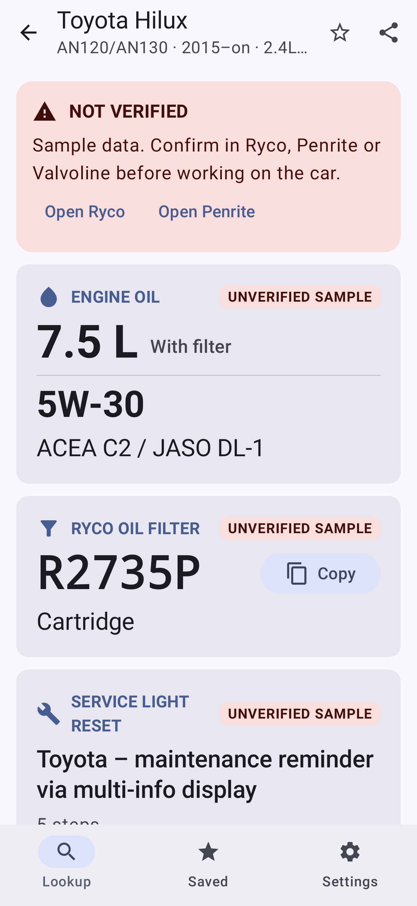
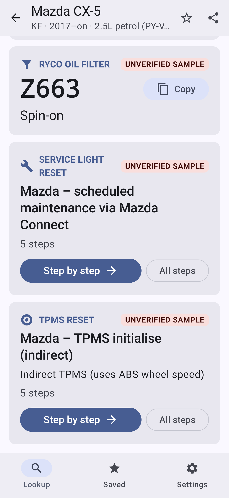
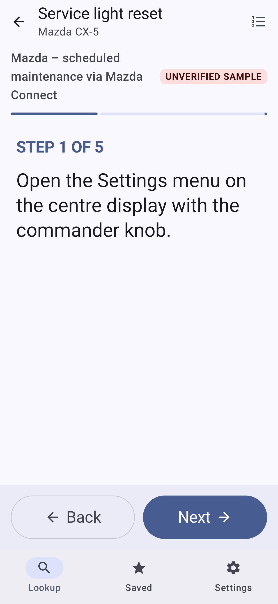
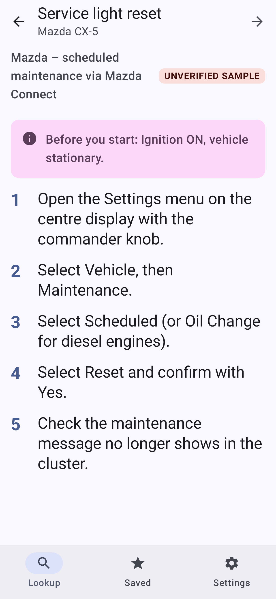
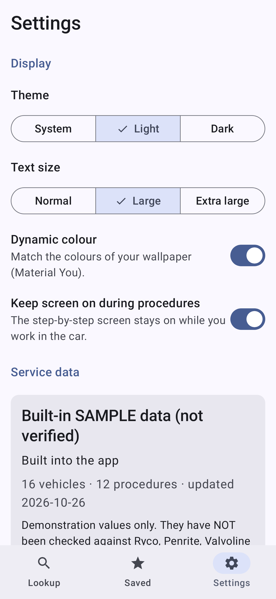
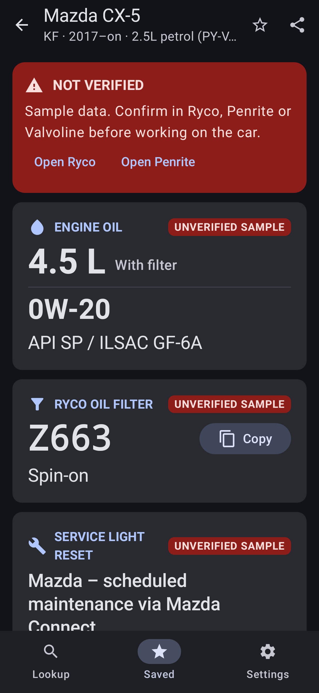

# Service Advisor

A counter and workshop lookup app for service advisors. Pick a vehicle and one screen shows:

1. **Engine oil**: refill capacity, SAE grade and required spec
2. **Ryco oil filter** part number, with a Copy button
3. **Service light reset**: a step-by-step procedure
4. **TPMS reset**: step by step, **shown only when the vehicle has TPMS**. When it doesn't, the section is not drawn at all.

It combines what the Valvoline and Penrite apps (oil and capacity by vehicle) and the Ryco app
(filter by vehicle) provide, so an advisor doesn't have to switch between three apps.

Kotlin, Jetpack Compose and Material 3. Targets and compiles against **Android 17 (API 37)**, minSdk 26.

| Lookup | Search | Sheet, no TPMS | Sheet with TPMS | Step | All steps | Settings | Dark |
|---|---|---|---|---|---|---|---|
|  |  |  |  |  |  |  |  |

## ⚠ The bundled data is sample data and is NOT verified

The 16 vehicles in `src/main/assets/vehicles.json` are there to demonstrate the app. **Nobody has
checked them against Ryco, Penrite, Valvoline or the vehicle makers. Some values will be wrong.**
The app never presents them as verified:

- The data file says `"verified": false`, and so does every vehicle record.
- The Lookup screen, every service sheet and Settings show a red **NOT VERIFIED** banner, with
  links to the Ryco and Penrite websites.
- Every value card (oil, filter, service reset, TPMS) has an **UNVERIFIED SAMPLE** tag, and the
  step-by-step screen has one too.
- Shared service sheets start with "⚠ UNVERIFIED SAMPLE DATA".
- A unit test (`SampleDataTest.sampleIsNeverPresentedAsVerified`) fails if the sample is ever
  marked as verified.

A record shows as checked only when the imported file sets `"verified": true` in its `info`
section **and** on that vehicle. The fix for real use is to load the workshop's own checked data
(see "Using real data" below).

## Install the APK

`ServiceAdvisor-1.0.0.apk` in the repository root is a minified release build (1.7 MB), signed
with a debug key for testing.

1. Copy it to an Android 8.0+ phone or tablet (or download it from GitHub on the device).
2. Open it and allow "Install unknown apps" for your browser or file manager when asked.

Or, with USB debugging on: `adb install ServiceAdvisor-1.0.0.apk`.

Because it is debug-signed, set up a proper release keystore before you distribute it beyond
testing. An APK signed with a different key can't be installed over this one. Uninstall it first.

## Menu structure, and why

There are three bottom tabs. On tablets and in landscape they become a side rail.

| Tab | What's on it |
|---|---|
| **Lookup** (home) | One search box at the top, then the 3 most recent vehicles, then a **Browse by make** grid. Make → Model → Engine → service sheet. |
| **Saved** | Starred vehicles (the workshop's regulars) and the full recent list. |
| **Settings** | Theme, text size, dynamic colour, keep-screen-on, and the service data file (status, import, template, restore). |

Why this layout:

- **Search first.** At the counter the customer usually says "2019 Hilux diesel". Typing
  `hilux 2.8` or `corolla 2016` gets there in one step. Every word must match, and a four-digit
  number matches the production years. It also does a reverse lookup: type a Ryco number such as
  `R2735P` to list every vehicle it fits. If there is only one match, pressing Search on the
  keyboard opens it.
- **Browse for when spelling or the model name is unclear.** Big make tiles lead to models. A
  model with one engine skips straight to its sheet, so there are never more than three taps.
- **One screen per vehicle, in priority order.** Oil capacity and grade come first, in the
  biggest type, then the filter, then the procedures. Phones show one column and tablets show two.
- **Procedures one step at a time.** "Step by step" opens a full-screen pager with a "Before you
  start" page, then one large step per page, a progress bar and 64 dp Back/Next buttons that
  are easy to hit with gloves. You can also swipe. The screen stays awake (this can be turned
  off). The list icon switches to all steps at once, and so does "All steps" on the sheet.
- **Saved instead of a history screen buried in a menu.** Recent vehicles also show on Lookup,
  because a repeat lookup a few minutes later is common.
- **Readability.** The text size defaults to Large (×1.15 on top of the system font scale) and
  has an Extra large option. Dynamic colour (Material You) and light/dark/system themes are
  supported.

## Using real data

The app reads one JSON file. In **Settings → Service data**:

- **Save template** writes the current format (the sample) to a file.
- Fill it in from Ryco, Penrite, Valvoline or the OEM data. Set `"verified": true` and a
  `"verifiedBy"` (for example `"J. Smith, 2026-11-02"`) in `info`, and `"verified": true` on each
  vehicle you checked.
- **Import data file** validates it and rejects the whole file if anything is wrong: broken
  procedure references, duplicate ids, empty steps, missing filter numbers or an implausible
  capacity. The reasons are listed. Imported data survives restarts. **Use built-in sample**
  goes back to the sample.

Format (see `src/main/java/com/serviceadvisor/app/data/Model.kt`):

```json
{
  "info": { "name": "Workshop data", "verified": true, "verifiedBy": "J. Smith", "updated": "2026-11-02" },
  "procedures": [
    { "id": "toyota-mid-service", "title": "…", "before": "Ignition ON", "steps": ["…", "…"] },
    { "id": "toyota-tpms-mid", "title": "…", "steps": ["…"], "tpmsType": "Direct" }
  ],
  "vehicles": [
    {
      "id": "toyota-hilux-an120-1gd", "make": "Toyota", "model": "Hilux", "series": "AN120",
      "yearFrom": 2015, "yearTo": null, "engine": "2.8L turbo diesel", "engineCode": "1GD-FTV", "fuel": "Diesel",
      "oil": { "capacityLitres": 7.5, "capacityNote": "With filter", "grade": "5W-30", "spec": "ACEA C2" },
      "oilFilter": { "ryco": "R2735P", "type": "Cartridge" },
      "serviceResetId": "toyota-mid-service",
      "tpmsResetId": null,
      "verified": true
    }
  ]
}
```

`tpmsResetId: null` means the vehicle has no TPMS, and the TPMS section is hidden.
`tools/make_sample.py` regenerates the bundled sample.

## Build and run in Android Studio

The app is the `:advisor` module of this repository's Gradle build. It shares the toolchain in
`gradle/libs.versions.toml` (AGP 9.4.1, Kotlin 2.4.21, Compose BOM 2026.09.00, Navigation 3).

1. Install a current Android Studio that supports AGP 9.4, plus SDK **Platform 37** and
   **Build-Tools 37.0.0** (SDK Manager).
2. **File → Open** the repository root. Let Gradle sync.
3. Pick the **advisor** run configuration and a device or emulator, then press **Run**.

Command line (JDK 17+):

```sh
./gradlew :advisor:assembleDebug        # advisor/build/outputs/apk/debug/advisor-debug.apk
./gradlew :advisor:assembleRelease      # minified, debug-signed: advisor/build/outputs/apk/release/
./gradlew :advisor:testDebugUnitTest    # data, search and Robolectric UI/screenshot tests
./gradlew :advisor:testDebugUnitTest -Proborazzi.test.record=true   # re-record docs screenshots
```

If Maven Central throttles Robolectric's download of its Android jars (HTTP 429), add
`-ProbolectricRepo=https://maven-central.storage-download.googleapis.com/maven2`.

## Code layout

```
data/      Model.kt (serializable data file) · DatasetParser.kt (parse + validate)
           ServiceDataRepository.kt (sample or imported file) · SettingsStore.kt (DataStore)
domain/    VehicleSearch.kt
ui/        AppRoot.kt (Navigation 3 + NavigationSuiteScaffold) · AdvisorViewModel.kt
           lookup/ sheet/ procedure/ saved/ settings/ components/ theme/
```

The app needs no permissions. Import uses the system file picker, and the website links open in
the browser.
